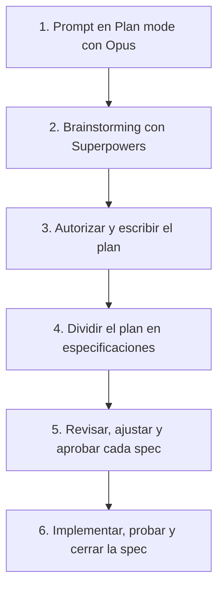
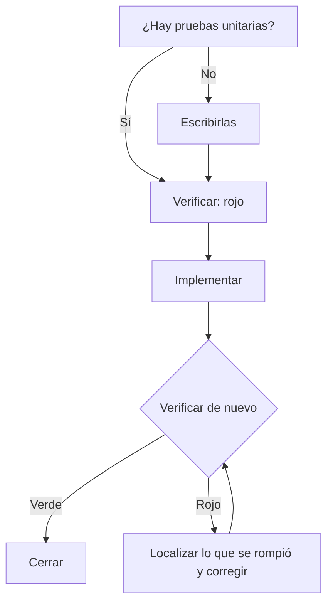

# Guía de Claude Code

Notas de uso: qué modelo elegir, con qué permisos trabajar, cómo cuidar el contexto y en qué orden avanzar.

## Contenido

- [Modelos](#modelos)
- [Modos de permisos](#modos-de-permisos)
- [Memoria, contexto y tokens](#memoria-contexto-y-tokens)
- [Plugins, MCP y skills](#plugins-mcp-y-skills)
- [Flujo SDD](#flujo-sdd)
- [Flujo TDD](#flujo-tdd)
- [Sugerencias generales](#sugerencias-generales)
- [Seguridad](#seguridad)
- [Comandos](#comandos)

## Modelos

| Modelo     | Úsalo para                                                                 |
| ---------- | -------------------------------------------------------------------------- |
| **Opus**   | Tareas complejas: planeación, especificaciones, arquitectura y decisiones. |
| **Sonnet** | Tareas intermedias: implementación de código y testing.                    |
| **Haiku**  | Tareas básicas: clasificación de archivos o registros.                     |

## Modos de permisos

| Modo       | Qué puede hacer                                                        | Ventaja                                              | Límite                                                    |
| ---------- | ---------------------------------------------------------------------- | ---------------------------------------------------- | --------------------------------------------------------- |
| **Manual** | Pide autorización para todo.                                           | Control total.                                       | Lento y depende de la interacción del desarrollador.      |
| **Edit**   | Edita archivos. Pide autorización para comandos, consultas y el resto. | Decisiones importantes bajo control y código fluido. | Sigue dependiendo de la interacción del desarrollador.    |
| **Auto**   | Hace todo, salvo lo que se le haya prohibido.                          | Implementación rápida.                               | Poco control. Inseguro si la configuración no está clara. |
| **Plan**   | Analiza, escribe planes y especificaciones. No implementa código.      | Ideal para planes y especificaciones.                | Se queda en el plan.                                      |

## Memoria, contexto y tokens

> Mantén la barra de contexto por debajo del **50%**. Pasado ese punto baja la coherencia y la confianza del código que genera el agente.

| Hábito                    | Cómo aplicarlo                                                                              |
| ------------------------- | ------------------------------------------------------------------------------------------- |
| Una sesión por tarea      | Limpia el contexto con `/clear` al cambiar de tema.                                         |
| Un solo tema por sesión   | Mantén la conversación en la misma tarea.                                                   |
| Salida más corta          | Configura los skills **Caveman** o **Ponytail** para gastar menos tokens de salida.         |
| Comandos fuera del chat   | Ejecútalos con `!` o en otra terminal.                                                      |
| Compactar con criterio    | Usa `/compact` solo cuando sea necesario para liberar contexto y seguir en la misma sesión. |
| Contexto principal limpio | Delega exploraciones y subprocesos a subagentes.                                            |
| Menos herramientas        | Deja activos solo los skills y plugins que el proyecto necesita.                            |

## Plugins, MCP y skills

| Herramienta                 | Para qué                                    |
| --------------------------- | ------------------------------------------- |
| **Superpowers**             | Planeación, brainstorming, TDD y worktrees. |
| **Context7**                | Documentación reciente y actualizada.       |
| **Code Intelligence (LSP)** | Skills de cada lenguaje.                    |
| **Code review**             | Revisión de código orientada a seguridad.   |
| **Code simplifier**         | Código más claro y simple.                  |
| **Frontend design**         | Diseño de interfaces.                       |
| **UI UX Pro Max**           | Mejoras de interfaz.                        |
| **Impeccable**              | Refinamiento de interfaces profesionales.   |
| **Playwright**              | Pruebas en el navegador en tiempo real.     |
| **Caveman**                 | Menos tokens de salida.                     |

## Flujo SDD

Secuencia flexible. Cada especificación se revisa y se cierra antes de pasar a la siguiente.

1. Escribe el prompt inicial con todos los detalles, en **Plan mode** y con **Opus**.
2. Haz un brainstorming con **Superpowers** para definir el plan.
3. Autoriza y escribe el plan.
4. Divide el plan en especificaciones.
5. Revisa, ajusta y aprueba cada especificación antes de implementarla.
6. Al terminar cada especificación, pruébala y ciérrala.

## Flujo TDD

El rojo inicial es el resultado esperado: las pruebas existen y aún fallan. El verde llega después de implementar.

1. Pide a **Superpowers** que compruebe si hay pruebas unitarias. Conviene usar subagentes.
2. Si no existen, escríbelas.
3. Corre la verificación antes de implementar. El resultado esperado es **rojo**.
4. Implementa el código.
5. Vuelve a verificar. El resultado esperado es **verde**.
6. Si sigue en rojo, el agente revisa qué se rompió y lo corrige hasta llegar a verde.

## Sugerencias generales

- Usa subagentes para revisión, exploración, testing o varias tareas en paralelo.
- Usa worktrees o ramas en tareas grandes y complejas.
- Instala plugins y skills en el nivel que convenga: **global**, **repositorio** o **local**.
- Revisa `/usage` con frecuencia. Evita encargar tareas largas cuando la sesión está por agotarse.

## Seguridad

- Nunca des acceso a producción.
- No des acceso a `.env`, llaves secretas ni archivos confidenciales.
- No compartas datos personales o confidenciales con el agente.
- Revisa skills y plugins de terceros antes de instalarlos.
- Define en qué ramas y repositorios puede trabajar el agente.
- No uses **Auto mode** en tareas críticas.

## Comandos

- [Claude Code cheatsheet](claudecode-cheatsheet.pdf)
- [Impeccable cheatsheet](impeccable-cheatsheet.pdf)
